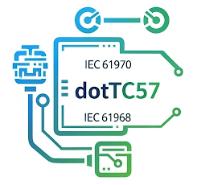

**`dotTC57`** is my MIT-licensed open-source .NET implementation of the IEC Technical Committee 57 (TC57) Common Information Model (IEC 61970 and IEC 61968). It gives developers both a strongly typed C# object model generated from the official CIM UML and a `.NET 10` reflection-based OWL 2 / RDF ontology generator.

- **GitHub Repository:** [github.com/s-o-w/dotTC57](https://github.com/s-o-w/dotTC57)
- **NuGet Package:** [nuget.org/packages/dotTC57](https://www.nuget.org/packages/dotTC57)
- **Live Generated Ontologies:** [Browse in the CIM100 Explorer](/cim/) · [Download `.ttl` / `.owl` / `.jsonld`](/cim/#hosted-ontology-downloads)

## Origin and Motivation

The first code for `dotTC57` was written in a hotel room during a 2023 industry consortium meeting: a script that parsed an XML/RDF CIM substation bay sample and rendered an SVG single-line diagram from it.

Building `dotTC57` solved two recurring problems with existing CIM tooling:

1. **Eliminating manual RDF/XML wrangling in .NET.** Native CIM RDF/XML is verbose and error-prone in application code. Strongly typed C# classes provide compile-time checking, IntelliSense, and clean integration with LINQ and Entity Framework Core.
2. **Replacing static hunt-and-peck profiles with full UML coverage.** Traditional CIMTool workflows require hand-picking classes and fields into a narrow derived profile up front. Substation and distribution design needs dynamic access to the full IEC 61970 and IEC 61968 model (`1,414` top-level types across `77` packages), using CIM natively and layering minimal extensions on top.

## Strongly Typed C# Usage

```csharp
using TC57CIM.IEC61970.Base.Core;
using TC57CIM.IEC61970.Base.Wires;

var substation = new Substation
{
    mRID = Guid.NewGuid(),
    name = "Main Street Substation",
};

var breaker = new Breaker
{
    mRID = Guid.NewGuid(),
    name = "CB-101",
};
```

## `.NET 10` OWL 2 & JSON Metadata Generator

`dotTC57.OwlGenerator` reflects directly over the compiled `dotTC57` assembly and its generated XML documentation (`dotTC57.xml`) to emit deterministic, W3C-compliant ontologies:

- **`iec61970.{ttl,owl,jsonld}`** (`807` types: `725` classes/datatypes, `82` enums; `35,799` triples)
- **`iec61968.{ttl,owl,jsonld}`** (`607` types: `435` classes, `172` enums; `25,540` triples; `owl:imports iec61970.ttl`)
- **`cim100.{ttl,owl,jsonld}`** (umbrella ontology importing both standards)
- **`cim-model.json`** (structured metadata index powering the [CIM100 Explorer](/cim/) on this site)

```bash
# Generate Turtle (.ttl), UTF-8 RDF/XML (.owl), JSON-LD 1.1 (.jsonld), and cim-model.json
dotnet run --project dotTC57.OwlGenerator -c Release -- generate --out ./out

# Verify all generated or hosted ontology files offline
dotnet run --project dotTC57.OwlGenerator -c Release -- verify --dir ./out

# Convert an external Turtle extension ontology to .owl and .jsonld
dotnet run --project dotTC57.OwlGenerator -c Release -- convert --in ./cimbology-kg.ttl --out-prefix ./out/cimbology-kg

# Run the automated xUnit OWL verification suite
dotnet test dotTC57.sln -c Release
```

Every emitted term preserves canonical `http://iec.ch/TC57/CIM100#` IRIs, OWL 2 DL anonymous `owl:oneOf` enum definitions, explicit `cimdoc:` package and Normative/Informative tier annotations, and open-world object properties so SHACL profiles can govern cardinality cleanly by use case.
